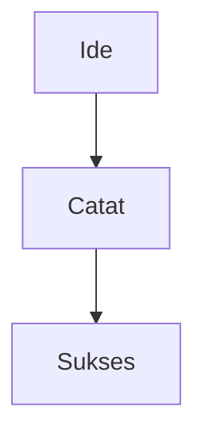
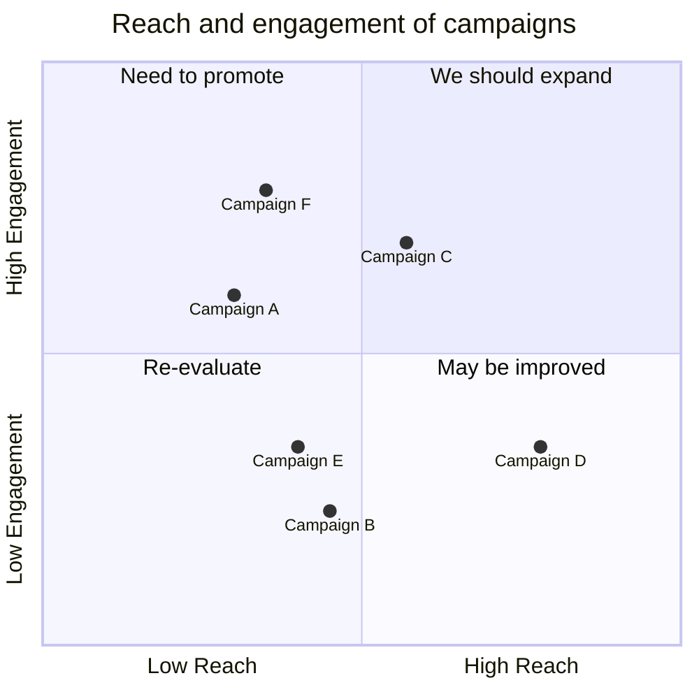
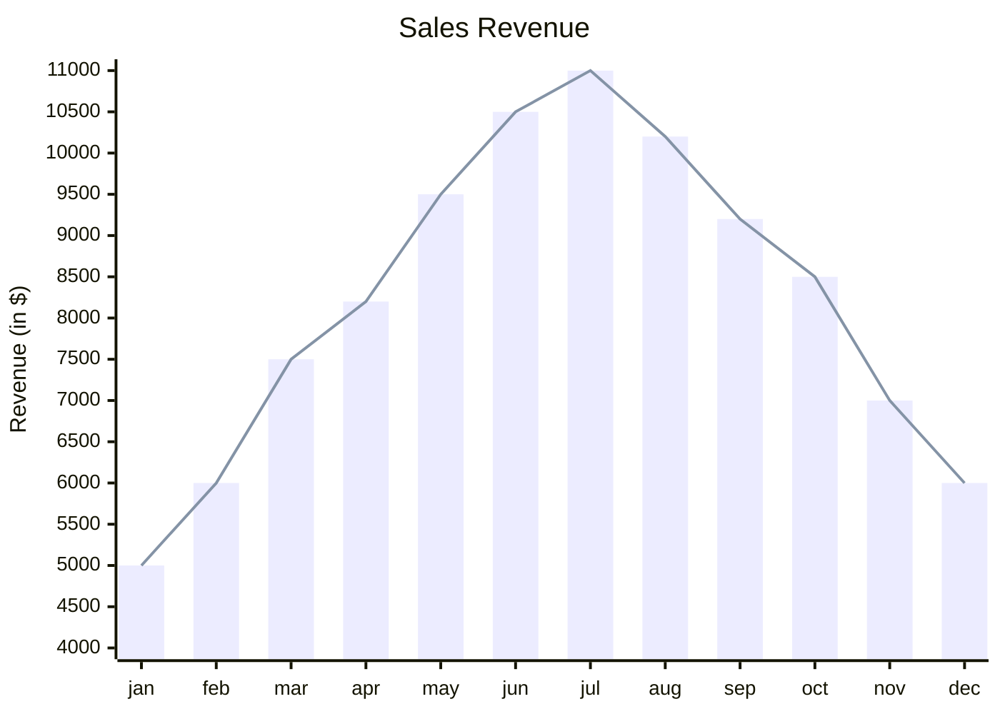
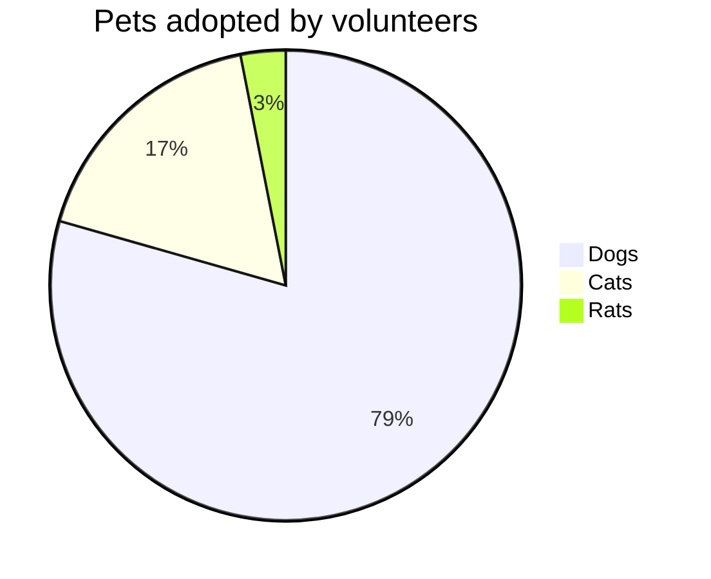

# Apa itu MAKA?

![[https://cdn.pixabay.com/video/2023/10/01/183108-870151713_large.mp4]]

Selamat datang di Maka! Mungkin Anda bertanya? Kenapa saya harus pakai ini?

Bayangkan Maka bukan sekadar aplikasi catatan biasa, tapi sebuah ruang kerja di mana pikiran Anda bisa saling terhubung. Motonya adalah :

> &quot;Connect your thoughts, build your world&quot; <div data-empty="false">(Hubungkan pikiranmu, bangun duniamu).</div>

Di Maka, kita tidak dipusingkan dengan tombol menu yang rumit. Semuanya tentang kesederhanaan dan kecepatan.

### 🌟 Mengapa Maka Berbeda?

Mari kita lihat perbedaannya dengan aplikasi catatan standar yang mungkin biasa Anda pakai:

| Fitur | Aplikasi Catatan Biasa 📒 | Maka Note 🧠 |
| --- | --- | --- |
| Penyimpanan | Tersimpan di server orang lain | Milik Anda 100% (File ada di komputer Anda) |
| Struktur | Folder kaku (seperti lemari arsip) | Jaring Laba-laba (Ide bisa saling terhubung) |

### 📦 Mengenal "The Vault" (Brankas)

![[Materi/0 - Pengenalan/Gambar/2 - Maka/Maka Vault.jpeg]]

Salah satu fitur terbaik untuk pemula adalah sistem Vault. Bayangkan Anda memiliki beberapa "kotak" berbeda untuk hidup Anda. Anda tidak ingin catatan Kerjaan Kantor bercampur dengan Resep Masakan, bukan?

- Pemisahan Total: Anda bisa membuat satu Vault untuk "Pribadi" dan satu Vault untuk "Kantor".
- Aman &amp; Fokus: Saat Anda membuka Vault "Kantor", Anda tidak akan terganggu oleh catatan rencana liburan Anda.

![[Materi/0 - Pengenalan/Gambar/2 - Maka/Maka Vault Explorer.jpeg]]

## Membangun "Otak Kedua" Anda 🔗

![[https://cdn.pixabay.com/video/2025/02/22/260163_large.mp4]]

Pernahkah Anda punya ide cemerlang, mencatatnya, lalu... lupa di mana menaruhnya? Atau Anda punya dua ide hebat yang sebenarnya berhubungan, tapi terpisah di buku catatan yang berbeda?

Maka hadir untuk menyelesaikan masalah itu dengan konsep "Second Brain" (Otak Kedua).

### 🔗 Internal Linking: Wikipedia Pribadi Anda

![[Materi/0 - Pengenalan/Gambar/2 - Maka/Maka Internal Linking.jpeg]]

Fitur paling powerful di Maka adalah Internal Linking.

Jika Anda pernah membaca Wikipedia, Anda pasti tahu teks berwarna biru yang bisa diklik untuk pindah ke topik lain, kan? Nah, Anda bisa membuat hal yang sama untuk catatan Anda sendiri!

Caranya sangat mudah:

1. Ketik tanda kurung siku dua kali: `[[`
2. Ketik nama catatan lain yang ingin dihubungkan.
3. Selesai!

Contoh Penggunaan:

Misalkan Anda sedang menulis di catatan "Resep Nasi Goreng". Anda bisa mengetik:

"Jangan lupa tambahkan `[[Bumbu Rahasia Nenek]]` agar makin sedap."

Saat Anda mengklik `Bumbu Rahasia Nenek`, Maka akan langsung membuka catatan tersebut. Tidak perlu lagi mencari-cari di dalam folder yang menumpuk!

![[Materi/0 - Pengenalan/Gambar/2 - Maka/Maka Media Selector.jpeg]]

### Fitur Pencarian Cepat (Address Bar) 🚀

![[Materi/0 - Pengenalan/Gambar/2 - Maka/Maka Adressbar.jpeg]]

Bayangkan Address Bar ini seperti "Google" pribadi untuk seluruh catatan di dalam Vault Anda. Hanya dengan beberapa ketikan, Anda bisa menemukan apa pun dalam hitungan detik.

Address Bar ini adalah kunci utama agar Anda tetap produktif tanpa harus "tersesat" di dalam tumpukan catatan Anda sendiri. Apakah penjelasan ini membantu Anda lebih memahami cara kerja pencariannya?

#### 🌟 Mengapa Ini Sangat Membantu?

1. Tidak Perlu Hafal Folder: Anda tidak perlu ingat di mana Anda menyimpan catatan "Lisensi Produk Digital". Cukup ketik "Lisensi", dan Maka akan menemukannya untuk Anda.
2. Pencarian Lintas Konten: Maka mencari hingga ke dalam isi teks (Content), bukan hanya judul file saja. Ini sangat berguna jika Anda ingat sebuah kalimat tapi lupa judul catatannya.
3. Super Cepat: Langsung tekan `Cmd + L` (atau `Ctrl + L`), ketik, dan tekan `Enter`. Navigasi tanpa menyentuh mouse sama sekali! 🖱️🚫

### 🕸️ Network Graph: Melihat "Rasi Bintang" Ide

![[Materi/0 - Pengenalan/Gambar/2 - Maka/Maka Network Graph.jpeg]]

Inilah fitur yang membuat pengguna baru sering berkata "Wow!" 😲.

Maka memiliki fitur Network Graph. Ini bukan sekadar grafik biasa. Ini adalah peta visual dari seluruh isi otak Anda.

- Setiap Titik (Node) adalah satu catatan.
- Setiap Garis adalah hubungan (link) yang Anda buat tadi.

Semakin sering Anda menghubungkan ide (menggunakan `[[link]]`), semakin kompleks dan indah grafik Anda. Anda bisa melihat bagaimana ide tentang "Hobi Memasak" ternyata berhubungan dengan ide "Ide Bisnis 2025". Anda bisa melihat pola pikir Anda sendiri!

> [!QUESTION] Question
> <p data-empty="false">Mari berimajinasi sejenak.</p><p data-empty="false">Jika isi kepala Anda saat ini digambar menjadi sebuah peta visual seperti di Maka, kira-kira bentuknya akan seperti apa?</p><p data-empty="false"><br>Apakah akan terlihat rapi dan lurus seperti Jalan Tol, <br>atau justru ruwet dan abstrak seperti Benang Kusut? <br><br>Ceritakan imajinasi visual Anda! 🎨</p>

## Fitur Keren untuk Kreativitas &amp; Teknis 🛠️

![[https://cdn.pixabay.com/video/2016/09/05/4952-181538531_large.mp4]]

Maka mengerti bahwa otak kita bekerja dengan berbagai cara. Ada yang butuh musik untuk fokus, ada yang butuh gambar visual untuk mengerti, dan ada yang butuh kerapian kode.

### 🎵 Built-in Music Support: Atur Mood Anda

![[Materi/0 - Pengenalan/Gambar/2 - Maka/Maka Bg Music.jpeg]]

Pernahkah Anda merasa ribet harus buka-tutup Spotify atau YouTube saat sedang asyik menulis? Di Maka, Anda tidak perlu pindah aplikasi!

- Fokus Penuh: Anda bisa memutar library audio Anda langsung di dalam Maka.
- Vibe: Cocok untuk menyetel musik lo-fi atau white noise agar sesi mencatat Anda makin produktif.

### 📊 Mermaid.js: Membuat Diagram Tanpa Menggambar

Ini fitur favorit bagi Anda yang suka membuat Flowchart atau bagan alur, tapi malas menggeser-geser kotak di aplikasi desain.

Maka menggunakan fitur bernama Mermaid. Jangan khawatir dengan namanya yang aneh, intinya adalah: Ubah Teks Menjadi Grafik.

Lihat perbandingannya:

| Cara Lama (Aplikasi Desain) 😩 | Cara Maka (Mermaid) 😎 |
| --- | --- |
| Buka aplikasi berat | Cukup ketik di catatan |
| Drag &amp; drop kotak satu per satu | Ketik A --&gt; B |
| Mengatur garis panah manual agar lurus | Maka merapikannya otomatis |
| Susah diedit kalau ada perubahan | Edit teksnya, grafik berubah sendiri |

Contoh kode sederhana yang bisa Anda coba nanti:









### 💻 Syntax Highlighting: Koding Jadi Cantik

```

```

Meskipun Anda bukan programmer, fitur ini tetap berguna!

Fitur ini membuat teks di dalam kotak kode menjadi warna-warni dan mudah dibaca. Sangat berguna jika Anda ingin menyimpan:

- Potongan skrip Excel/Google Sheets.
- Snippet kode HTML untuk blog.
- Atau sekadar catatan teknis yang ingin terlihat beda.

> [!QUESTION] Pilih Tim Anda
> <p data-empty="false">Bicara soal produktivitas saat menggunakan Maka nanti, Anda termasuk tipe yang mana?</p><p data-empty="false">-&nbsp;<b>Tim Hening</b> 🤫
> "Saya butuh kesunyian total agar bisa berpikir jernih." VS</p><p data-empty="false"><b>- Tim Musik</b> 🎧
> "Tanpa musik latar (seperti fitur musik di Maka), otak saya justru macet!"</p><p data-empty="false"><br>Ketik "Tim Hening" atau "Tim Musik" di balasan Anda! Mari kita lihat siapa yang paling banyak. 👇&nbsp;</p>

## Mempercantik Catatan (Rich Media) 🎨

![[https://cdn.pixabay.com/video/2021/10/10/91597-628463750_large.mp4]]

Siapa bilang catatan teks itu harus hitam putih dan membosankan? Di Maka, kita bisa membuat catatan yang hidup, interaktif, dan enak dipandang mata.

### 🖼️ Gambar &amp; Video: Visual Itu Penting

Kadang, satu gambar bisa menjelaskan seribu kata. Maka membuatnya sangat mudah untuk menyisipkan media visual.

- Wiki-Style Images: Lupakan cara ribet "Insert &gt; Image". Di sini, jika Anda punya gambar di dalam folder Anda, cukup ketik tanda seru dan kurung siku:`![[FotoLiburan.jpg]]`Maka gambar itu akan langsung muncul!
- Video YouTube: Menemukan tutorial coding atau resep masakan di YouTube? Cukup Copy &amp; Paste link URL-nya ke dalam catatan Anda. Maka akan otomatis mengubahnya menjadi pemutar video. Anda bisa menonton sambil mencatat tanpa perlu pindah tab! 📺

> [!TIP] Pro Tip
> <p data-empty="false">Anda bisa copy paste image langsung dari internet, dengan menggunakan image block, maka gambar akan secara otomatis masuk ke vault. <br><b>Pasted image 20260212212216.png</b></p>

### ⚠️ Admonitions: Kotak-Kotak Ajaib

Ini adalah fitur rahasia agar catatan Anda terlihat profesional seperti buku panduan.

Admonitions (atau Callouts) adalah kotak berwarna-warni yang menonjolkan informasi penting. Anda tidak perlu mewarnai manual, cukup gunakan kode sederhana.

Contoh Penggunaan:

> [!TIP] Pro Tip
> <p>Gunakan blok &quot;Info&quot; (biru) untuk menandai tips cepat atau rangkuman.</p>

> [!WARNING] Awas Lupa!
> <p>Gunakan blok &quot;Warning&quot; (kuning) untuk hal-hal yang tidak boleh dilewatkan, seperti tenggat waktu.</p>

> [!QUOTE] Kutipan Hari Ini
> <p>Cara terbaik untuk memprediksi masa depan adalah dengan menciptakannya.</p>

Maka menyediakan banyak "rasa" untuk kotak-kotak ini:

- `note` (catatan biasa)
- `abstract` (ringkasan)
- `success` (hijau - untuk keberhasilan)
- `failure` (merah - untuk error/kesalahan)
- `question` (tanda tanya)
- `bug` (untuk lapor error)

---

> [!QUESTION] Jujur-jujuran
> <p data-empty="false">Saya punya pengakuan dosa: Kadang saya terlalu asyik menghias catatan dengan Admonitions warna-warni sampai lupa menulis isi catatannya! 😅</p><p data-empty="false"><br>Bagaimana dengan Anda?
> Apakah Anda tim <br>- "Isi Dulu, Hias Belakangan" (Fungsional) atau tim <br>- "Hias Dulu Biar Semangat Nulis" (Estetik)?</p><p data-empty="false"><br>Beri tahu saya strategi Anda di kolom komentar! 👇</p>

## Jalan Pintas (Keyboard Shortcuts) ⚡

![[https://cdn.pixabay.com/video/2024/09/21/232538_large.mp4]]

Ingin bekerja secepat kilat tanpa perlu menyentuh mouse? Maka didesain untuk kecepatan.

Berikut adalah tombol rahasia (Shortcuts) yang dikelompokkan agar mudah dihafal.

(Catatan: Jika Anda menggunakan Windows, tombol `Option` biasanya adalah `Alt`, dan `Cmd` adalah `Ctrl`)

### 🎮 1. Navigasi &amp; Mode Tampilan

Tombol-tombol ini berguna saat Anda sedang membaca ulang catatan atau mempresentasikannya kepada orang lain.

| Tombol | Fungsi |
| --- | --- |
| Space | Lanjut ke slide/halaman berikutnya (Sangat cepat!) |
| ← / → | Pindah ke slide sebelumnya atau selanjutnya |
| ↑ / ↓ | Scrolling (Menggulung layar) biasa |
| Option + F | Ganti Mode Edit: Berpindah antara Mode Menulis (Editor), Kode Sumber (Source), atau Presentasi (Present) |

### 🗂️ 2. Mengatur Panel (Bersih-bersih Layar)

Kadang kita butuh layar penuh untuk fokus, kadang kita butuh melihat semua panel. Gunakan tombol ini untuk menyembunyikan atau memunculkan panel samping.

| Tombol | Fungsi |
| --- | --- |
| Option + V | Buka/Tutup Panel Vault (Daftar File) |
| Option + T | Buka/Tutup Panel TOC (Daftar Isi) |
| Option + L | Buka/Tutup Panel Link (Hubungan Catatan) |
| Option + G | Buka Network Graph (Peta Pikiran) 🕸️ |
| Escape | Menutup semua panel/overlay yang terbuka |

### 📝 3. Manajemen Editor &amp; Tab

Bekerja dengan banyak catatan sekaligus? Ini solusinya.

| Tombol | Fungsi |
| --- | --- |
| Cmd + T | Buka Tab Baru (Seperti di Browser) |
| Cmd + W | Tutup Tab saat ini |
| Cmd + L | Fokus ke Kolom Pencarian (Cari catatan dengan cepat) 🔍 |
| Cmd + O | Buka Vault lain |
| Option + O | Pilih Vault yang aktif |

### 🎧 4. Suasana (Vibe) &amp; Ekspresi

Ini adalah fitur unik Maka yang membuat mencatat jadi tidak membosankan!

| Tombol | Fungsi |
| --- | --- |
| Option + B | Ganti Musik: Putar siklus mode musik (Default ➡️ Chill ➡️ Thinking) 🎵 |
| Option + M | Mute: Matikan/Nyalakan suara musik |
| Option + 1 | Mindblown: Efek kepala meledak dengan confetti! 🤯 |
| Option + 2 | Party: Efek pesta perayaan! 🎉 |

---

> [!SUCCESS] Fun Shortcut
> <p data-empty="false">Saya menantang Anda untuk mencoba satu kombinasi tombol sekarang juga!<br><br>Tekan <b>Option + 1</b> (atau <b>Alt + 1</b>) di keyboard Anda saat membuka Maka.</p><p data-empty="false">Katakan pada saya, apakah efek *confetti*-nya membuat Anda tersenyum? <br><br>Bagikan reaksimu!</p>
