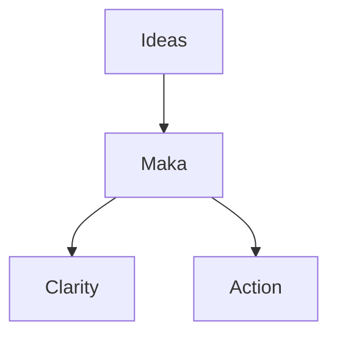

[](https://www.youtube.com/watch?v=6f9EbDbejfI)

# Welcome to Maka

> **Connect your thoughts,**
> **build your world.**

Maka is a powerful, Markdown-based workspace designed to turn your notes into a structured, visual environment without the clutter of complex menus. Everything is stored locally, keeping you in full control of your data.

## Simple & Powerful

Maka combines the simplicity of plain text with the power of a relational database. It’s designed to grow with your ideas.

- **Markdown-First**: Write in a clean, standard format that you truly own. No proprietary lock-ins.
- **The Vault System**: Organize your projects into independent "Vaults." Keep your work, personal life, and research completely separate but equally accessible.
- **Internal Linking**: Build a "second brain" using `[[internal links]]`. Connect ideas instantly and navigate your knowledge like your own personal Wikipedia.
- **Fast Search (Address Bar)**: Press `Cmd + L` (or `Ctrl + L`) to search through titles and content across your Vault instantly. Navigate without touching your mouse!
- **Network Graph**: Visualize the invisible. See how your thoughts intersect with an interactive graph that maps the relationships between your notes.
- **Built-in Music Support**: Set the mood for your focus sessions. Manage and play your audio library directly within the app without switching to external apps.
- **Mermaid.js Integration**: Turn text into professional diagrams, flowcharts, pie charts, and Gantt charts effortlessly.

## Technical Clarity

Maka is built with developers and power users in mind.

### Syntax Highlighting

Document your logic with clean, readable code blocks:

```javascript
function welcomeMaka() {
  console.log("Connect your thoughts, build your world.");
}
```

### Mermaid Diagrams

Visualize complex workflows or structures directly within your notes. Maka supports Flowcharts, Quadrant Charts, XY Charts, Pie Charts, and more:



## Rich Media & Wiki Links

Bring your world to life with integrated media support.

- **Wiki-Style Images**: Easily link and display assets using `![[image.jpg]]` syntax. You can even paste images directly from the web!
- **Video Integration**: Embed YouTube videos simply by pasting the URL. Watch while taking notes without switching tabs.
- **Admonitions**: Use "Callout" blocks to highlight specific types of information:

> [!info] Pro Tip
> Use Info blocks to highlight key takeaways or shortcuts.

> [!warning] Take Note
> Use Warning blocks to flag important details you shouldn't overlook.

more list of admonitions types : `note`, `abstract`, `info`, `todo`, `tip`, `success`, `question`, `warning`, `failure`, `danger`, `bug`, `example`, `quote`

## Keyboard Shortcuts ⚡

Work at lightning speed without taking your hands off the keyboard. *(Note: On Windows, use `Alt` instead of `Option` and `Ctrl` instead of `Cmd`)*.

### 1. Navigation & View Mode
| Shortcut | Function |
| --- | --- |
| `Space` | Fast forward to next slide/page |
| `←` / `→` | Previous/Next presentation slide |
| `Option + F` | Toggle View Mode (Editor, Source, or Presentation) |

### 2. Panel Management
| Shortcut | Function |
| --- | --- |
| `Option + V` | Toggle Vault Panel |
| `Option + T` | Toggle Table of Contents (TOC) |
| `Option + L` | Toggle Links Panel |
| `Option + G` | Open Network Graph 🕸️ |
| `Escape` | Close all active overlay panels |

### 3. Editor & Tabs
| Shortcut | Function |
| --- | --- |
| `Cmd + T` | Open New Tab |
| `Cmd + W` | Close current Tab |
| `Cmd + L` | Focus Address Bar (Search) 🔍 |
| `Cmd + O` | Open another Vault |
| `Option + O` | Select active Vault |

### 4. Vibe & Expression
| Shortcut | Function |
| --- | --- |
| `Option + B` | Cycle Background Music (Default ➡️ Chill ➡️ Thinking) 🎵 |
| `Option + M` | Mute / Unmute Music |
| `Option + 1` | 🤯 Mindblown Confetti Effect! |
| `Option + 2` | 🎉 Party Confetti Effect! |

## Author Notes (Agung Sundoro)


👋😁 Hi there, I'm Agung Sundoro aka agung2001, an AI enthusiast from Indonesia 🇮🇩
thank you for using Maka! I hope you enjoy using it as much as I enjoyed building it.
if you want to contact me, you can visit my website at https://agungsundoro.com