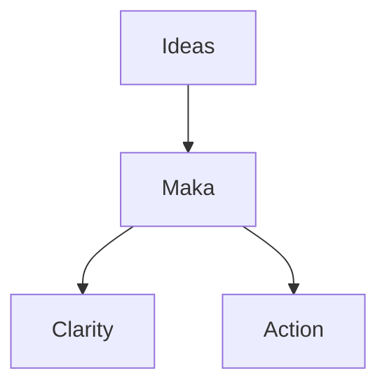

# Welcome to Maka

> **Connect your thoughts,**
> **build your world.**

Maka is a powerful, Markdown-based workspace designed to turn your notes into a structured, visual environment without the clutter of complex menus.

## Simple & Powerful

Maka combines the simplicity of plain text with the power of a relational database. It’s designed to grow with your ideas.

- **Markdown-First**: Write in a clean, standard format that you truly own. No proprietary lock-ins.
- **The Vault System**: Organize your projects into independent "Vaults." Keep your work, personal life, and research completely separate but equally accessible.
- **Internal Linking**: Build a "second brain" using `[[internal links]]`. Connect ideas instantly and navigate your knowledge like your own personal Wikipedia.
- **Network Graph**: Visualize the invisible. See how your thoughts intersect with an interactive graph that maps the relationships between your notes.
- **Built-in Music Support**: Set the mood for your focus sessions. Manage and play your audio library directly within the app.
- **Mermaid.js Integration**: Turn text into professional diagrams, flowcharts, and Gantt charts effortlessly.

## Technical Clarity

Maka is built with developers and power users in mind.

### Syntax Highlighting

Document your logic with clean, readable code blocks:

```javascript
function welcomeMaka() {
  console.log("Connect your thoughts, build your world.");
}
```

### Mermaid Diagrams

Visualize complex workflows or structures directly within your notes:



## Rich Media & Wiki Links

Bring your world to life with integrated media support.

- **Wiki-Style Images**: Easily link and display assets using `![[image.jpg]]` syntax.
- **Video Integration**: Embed YouTube videos simply by pasting the URL.
- **Admonitions**: Use "Callout" blocks to highlight specific types of information:

> [!info] Pro Tip
> Use Info blocks to highlight key takeaways or shortcuts.

> [!warning] Take Note
> Use Warning blocks to flag important details you shouldn't overlook.

more list of admonitions types : `note`, `abstract`, `info`, `todo`, `tip`, `success`, `question`, `warning`, `failure`, `danger`, `bug`, `example`, `quote`

## Author Notes (Agung Sundoro)


👋😁 Hi there, I'm Agung Sundoro aka agung2001, an AI enthusiast from Indonesia 🇮🇩
thank you for using Maka! I hope you enjoy using it as much as I enjoyed building it.
if you want to contact me, you can visit my website at https://agungsundoro.com